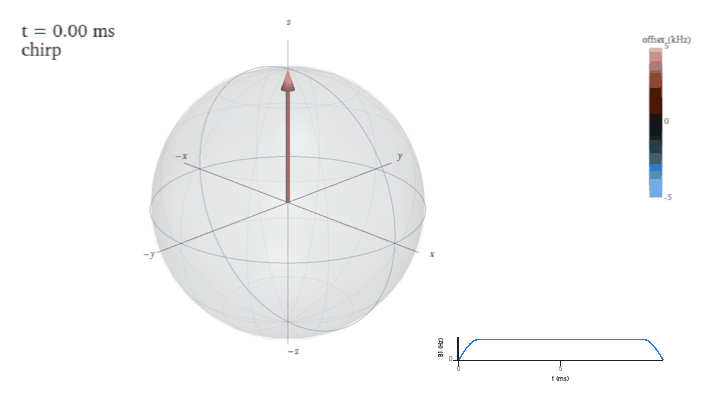

# Nutate

Bloch simulations of RF pulse sequences, rendered as 3D Bloch-sphere videos.



Nutate simulates magnetization trajectories in the rotating frame for many offsets at
once, then renders them with [PyVista](https://pyvista.org) as MP4/GIF videos, PNG stills,
or an interactive viewer. It covers hard and composite pulses, linear chirps, hyperbolic-secant
pulses, CHORUS (NMR and compressed EPR versions) and Bruker shape files, and maps robustness
to RF (B1) amplitude errors.

## Install

```bash
pip install git+https://github.com/mforoozandeh/nutate
```

(`pip install nutate` after the first PyPI release.) Python ≥ 3.11. Video encoding uses
the ffmpeg binary bundled with `imageio-ffmpeg`; no system ffmpeg or LaTeX needed.

## Quickstart

```python
import numpy as np
import nutate as nt

pulse = nt.chirp(10e-3, 20e3, 500, smoothing=10)
traj = nt.simulate([pulse], offsets=np.linspace(-5e3, 5e3, 31))
nt.render(traj, "chirp.mp4", duration=12)
```

Units are SI throughout (seconds, hertz, radians); arguments in degrees end in `_deg`.

Useful `render` options:

- `offsets`: draw only `k` evenly spaced offsets, or given indices
- `mode`: `"arrows"`, `"ribbon"` (a curve through all tips) or `"both"`
- `trail`: fading tip trails, as a fraction of the sequence
- `inset` / `inset_phase`: RF amplitude (and phase) vs time with a moving cursor
- `style=nt.Style(theme="dark")`, `camera=nt.Camera(orbit=90)`

`nt.snapshot(...)` writes a PNG still; `nt.show(traj)` opens an interactive window with a
time slider. `nt.plot_profiles(traj)` and `nt.plot_map(traj)` make the 2D excitation
profile and time–offset map plots.

### Your own waveform

`nt.waveform` turns a waveform normalised to 1 (amplitude and phase, or I and Q) into a
pulse; `rabi` is the Rabi frequency in Hz at waveform value 1, or `t90` the hard 90° pulse
length (`rabi = 1/(4·t90)`). `nt.run` then writes the video and/or the B1 figures:

```python
p1 = nt.waveform(amp, phase, duration=2e-3, rabi=15e3)        # or phase_deg=...
p2 = nt.waveform(i=I, q=Q, duration=1e-3, t90=10e-6)

result = nt.run([p1, p2], bandwidth=300e3, b1=True, out="output", name="my_pulse")
# output/my_pulse.mp4, my_pulse_b1_map.png, my_pulse_b1_surface.png, my_pulse_b1_phase.png
```

Pulses in a list play back to back. `video=False` skips the video, `video_options` go to
`nt.render`, and `component="z"` maps −Mz (inversion) instead of −My. `result` holds the
trajectory, the B1 map and the files written.

### B1 robustness

```python
pulse = nt.hard(10e-6, n_steps=1)                 # 90° at Ω1(0) = 25 kHz
offsets = np.linspace(-100e3, 100e3, 101)         # Δ/Ω1(0) from −4 to 4
scales = np.linspace(0.5, 1.5, 101)               # Ω1 / Ω1(0)
bmap = nt.b1_map([pulse], offsets, scales)
nt.plot_b1_map(bmap, "y", sign=-1)                # contours over Δ/Ω1(0) × Ω1/Ω1(0)
nt.plot_b1_map(bmap, "y", sign=-1, surface=True)
nt.plot_b1_phase(scales, nt.b1_phase_sensitivity([pulse], scales))
```

Sequences whose phase varies quickly across the band, such as a single chirp, need dense
offsets; `examples/b1_chirp.py` uses 1000, as the original script did.

`simulate(..., b1=...)` scales every RF amplitude (one factor, or one per offset);
`simulate_final` returns only the final states, which keeps large grids small in memory.
`phase_correction(sequence, bandwidth, ...)` fits the first-chirp phase correction for any
CHORUS-like sequence.

## Examples

Each video script writes `output/<name>.mp4` and `.png`; the `b1_*` scripts write
`output/<name>_map.png`, `_surface.png` and `_phase.png`. `--show` and `--out DIR` work
for all of them; `--theme dark` for the videos.

| Example | Shows |
|---|---|
| [`examples/chirp.py`](examples/chirp.py) | linear chirp excitation |
| [`examples/chirp_rewind.py`](examples/chirp_rewind.py) | a chirp, then an ideal rewind of its quadratic phase |
| [`examples/hard_pulse.py`](examples/hard_pulse.py) | a hard 90° pulse over a wide offset range |
| [`examples/composite.py`](examples/composite.py) | composite pulses (`--preset N`, `--window W` in units of Ω1) |
| [`examples/chorus.py`](examples/chorus.py) | CHORUS with phase correction, plus excitation profiles |
| [`examples/compressed_chorus_epr.py`](examples/compressed_chorus_epr.py) | compressed CHORUS for EPR, plus a time–offset map and phase paths |
| [`examples/bruker_shape.py`](examples/bruker_shape.py) | any Bruker shape file |
| [`examples/b1_hard.py`](examples/b1_hard.py) | B1 map and phase sensitivity: hard 90° pulse |
| [`examples/b1_composite.py`](examples/b1_composite.py) | B1 map and phase sensitivity: composite pulses |
| [`examples/b1_chirp.py`](examples/b1_chirp.py) | B1 map and phase sensitivity: single chirp |
| [`examples/b1_double_chirp.py`](examples/b1_double_chirp.py) | B1 map and phase sensitivity: double chirp |
| [`examples/b1_chorus.py`](examples/b1_chorus.py) | B1 map and phase sensitivity: CHORUS |
| [`examples/b1_abstruse.py`](examples/b1_abstruse.py) | B1 map and phase sensitivity: ABSTRUSE (hyperbolic-secant pulses) |

## Conventions

- Rotating frame, no relaxation; initial magnetization `(0, 0, 1)`.
- Each step rotates the magnetization by `+α = 2π·sqrt(Ω² + Δ²)·dt` (right-handed) about
  `n = (sinθ cosφ, sinθ sinφ, cosθ)` with `θ = atan2(Ω, Δ)`, for RF amplitude `Ω`, phase
  `φ` and offset `Δ` — i.e. `Rz(φ)·Ry(θ)·Rz(α)·Ry(−θ)·Rz(−φ)`. So an on-resonance 90°
  pulse with phase 0 takes `z → −y`.
- Profile phase is `angle(My + i·Mx)`.

## Headless rendering

Videos are rendered off-screen. On a server without a display, VTK needs an off-screen
OpenGL context (OSMesa/EGL or a virtual display); see the off-screen rendering notes in the
[PyVista documentation](https://docs.pyvista.org).

## Citation

If you use `nutate` in published work, please cite it; see [`CITATION.cff`](CITATION.cff).

## License

Apache License 2.0 — see [`LICENSE`](LICENSE) and [`NOTICE`](NOTICE).
